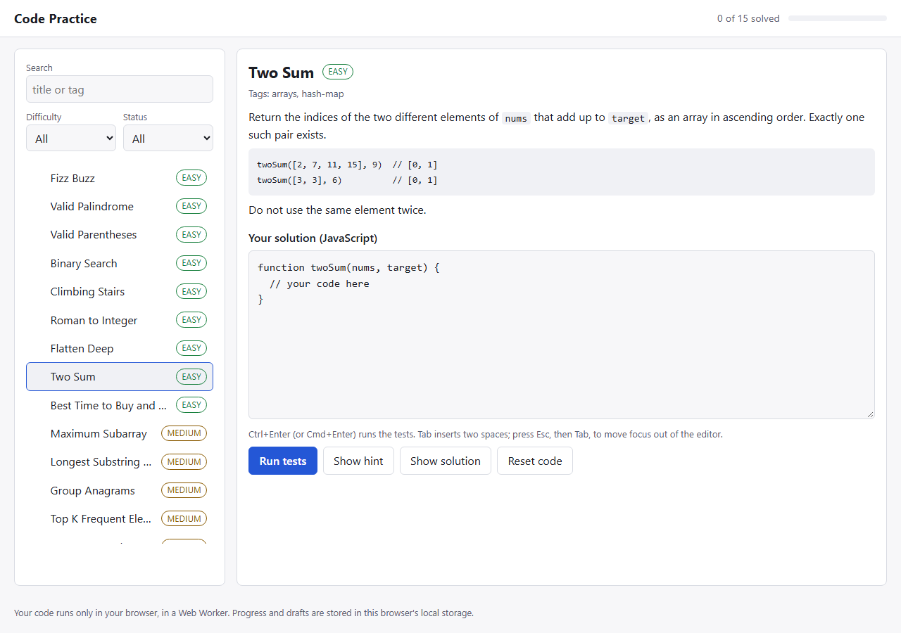

# code-practice-app

A small coding practice app that runs entirely in the browser: pick a problem, write JavaScript in the editor, and run it against visible and hidden tests. It has no dependencies and no build step. It is a learning and showcase project, not a replacement for LeetCode or Exercism.



## What it does

- 15 problems (9 easy, 6 medium) covering strings, arrays, hash maps, stacks, sliding window, intervals, matrices and simple dynamic programming.
- Each problem has 3 visible tests and 2 to 4 hidden ones. Hidden tests report only pass or fail, never their input or expected value, so you cannot special-case them.
- Your code runs in a Web Worker, away from the page. A run that takes more than 5 seconds is terminated and reported as "Time limit exceeded", so an infinite loop cannot freeze the app.
- Results show input, expected and actual output per visible test, thrown errors, and timing. Syntax errors and a missing function name are reported before any test runs.
- Hints (one at a time), a reference solution with its complexity (asking for it on an unsolved problem needs a second click), and a reset button that also needs a second click.
- Progress and your drafts are saved in this browser's local storage. Nothing is sent anywhere. Search, difficulty and status filters. Light and dark themes follow the system setting. Ctrl+Enter or Cmd+Enter runs the tests.

## Run it

Needs Node 20 or newer, only to serve static files and to run the tests.

```
npm start            # http://127.0.0.1:8080/   (PORT=3000 npm start to change the port)
npm test             # 45 tests
```

Open it over http, not by double-clicking `index.html`: browsers do not start Web Workers from `file://` pages, and the app then shows an error saying so. Any static server works, for example `python -m http.server`. `npm start` serves only `index.html` and `src/`.

## How it is built

```
index.html, src/styles.css   page and styling
src/app.js                   DOM only: rendering, editor, buttons, the Worker with its timeout
src/core.js                  runs a problem's tests against source code; also used by the Node tests
src/worker.js                Web Worker wrapper around core.js
src/lib.js                   filtering, the small text format for prompts, and the progress store (all UI-free)
src/problems.js              problem data only (plain objects, so they can be posted to the Worker)
src/solutions.js             reference solutions with explanations
fixtures/wrong-solutions.js  one plausible wrong solution per problem, used by the tests
scripts/serve.js             the static server behind `npm start`
test/                        node:test suites
```

A problem is a plain object: `id`, `title`, `difficulty`, `tags`, the function name `fn`, a `prompt` (paragraphs, `- ` lists, `` `code` `` and fenced blocks), a `starter`, `hints`, `tests`, `hidden` tests, and an optional `compare` mode (`exact`, `unordered`, or `unorderedNested`) for problems whose answer is a set, such as Group Anagrams. To add a problem, add an entry to `problems.js`, a reference solution to `solutions.js` and a wrong solution to `fixtures/wrong-solutions.js`; the tests then check all three against each other.

## How it is tested

45 Node tests, all passing on Node 24 on Windows:

- **Runner behaviour** (`core.test.js`): correct and wrong answers, thrown errors, syntax errors, a missing function, top-level code that throws, arguments mutated by the learner's code not leaking into later tests, unordered comparison, `NaN`, and a never-returning function being stopped by an outside timeout.
- **The problems themselves** (`problems.test.js`): every starter fails, every reference solution passes everything, and every known-wrong solution fails. Bugs marked `hiddenOnly` must pass every visible test and be caught only by a hidden one, which is what shows the hidden tests are doing something.
- **Independent oracles** (`oracles.test.js`): for 10 of the 15 problems the expected values are re-derived by deliberately naive brute-force code (every subarray, every buy/sell pair, every substring, point coverage for intervals, an encoder for Roman numerals, the rotation index formula). Writing these found two mistakes in my own test data: `climbStairs(45)` was written as 1,836,311 instead of 1,836,311,903, and one Two Sum case had two valid pairs although the prompt promises exactly one.
- **Helpers and server** (`lib.test.js`, `serve.test.js`): the prompt text format, filters, the progress store with corrupt, missing or full storage, and path traversal attempts against the static server.

Beyond those, I drove the real page in headless Chrome once, by hand, with a throwaway script against a copy of the app: pass, fail, syntax error, thrown error, an infinite loop (stopped after 5 seconds, run button usable again), draft saving across problems, filters, hints, the two-step solution and reset buttons. All of that behaved as described. That script is not part of the repo, so the browser UI has no automated test here.

## Limits

- JavaScript only, one function per problem, 15 problems. No accounts, leaderboard or sync between browsers. Clearing site data clears progress.
- The Web Worker keeps a runaway loop away from the page, but it is not a security sandbox: a worker can still make network requests. It is meant for running your own code on your own machine. Do not paste code you do not trust.
- Timing is a single wall-clock reading per test with no performance grading, so a slow-but-correct solution passes if it finishes within the 5 second limit for the whole run.
- The editor is a plain textarea with Tab handling. There is no syntax highlighting, autocomplete or line numbers. Press Esc and then Tab to move keyboard focus out of the editor.
- Tested in Chrome only (headless, once, as above). Other browsers are untested, though the app uses only standard APIs (`Worker`, `structuredClone`, `localStorage`).
- The difficulty labels are my own judgement; they are not calibrated against any other site.
- Not deployed anywhere. To publish it, enable GitHub Pages for the repository and serve the repository root.
- CI: the workflow (`.github/workflows/ci.yml`) runs `npm test` on Node 20, 22 and 24. It ran green on all three on the first run on GitHub Actions (ubuntu-latest, 2026-10-20).

## Clone

```
git clone https://github.com/Supp3r-Man/code-practice-app.git
cd code-practice-app
npm start
```

MIT licensed.
